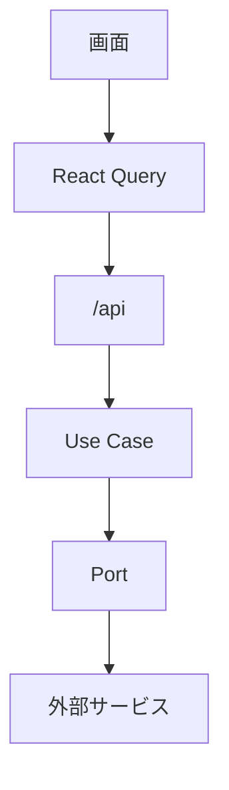
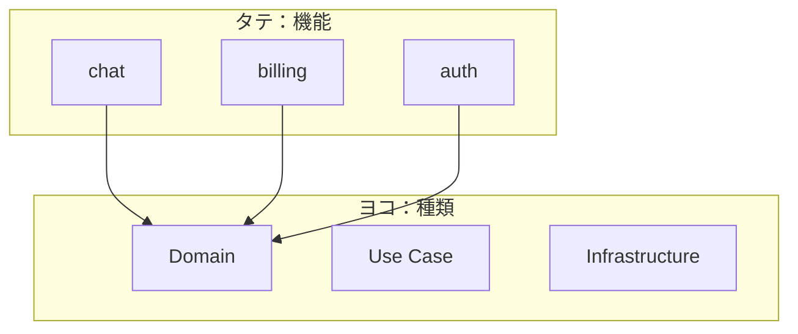
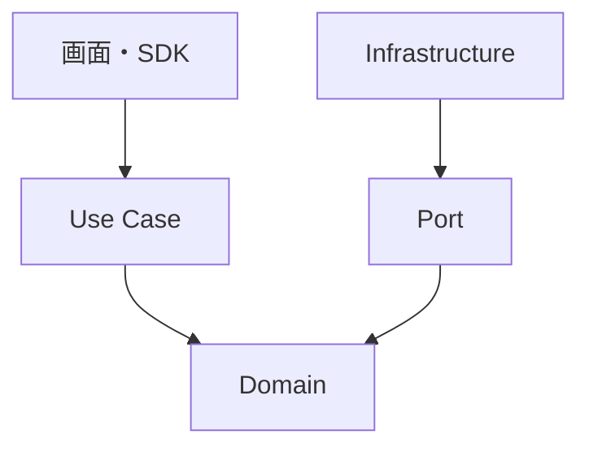
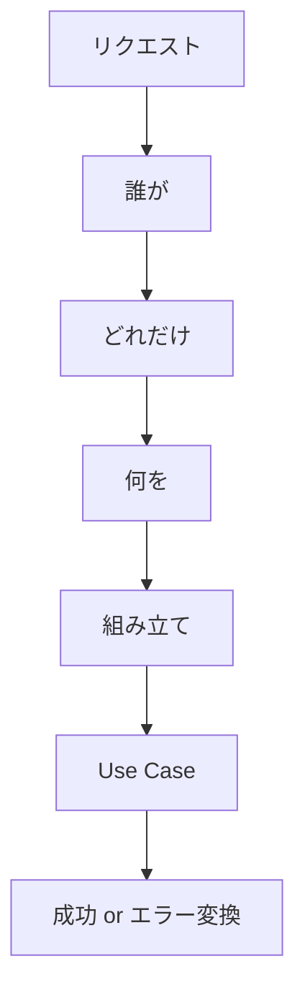
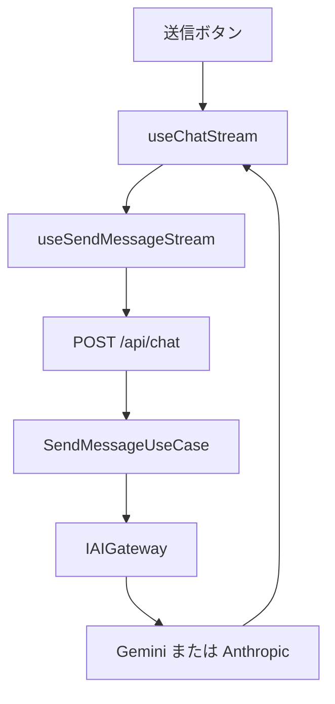

# このプロジェクトの設計

スマホで読むための短い読み物。
5〜8分で全体像が掴める。

コードを1ファイルずつ追う解説は
[beginner-architecture-guide.md](./beginner-architecture-guide.md)
へ。

---

## 1. いまの地図

あなたの経験は人それぞれなので、
「よくある分かれ目」で整理する。

### たぶん知っている

- Next.js に
  ページと API がある
- React で画面を書く
- TypeScript で型を付ける
- Chat / ログイン /
  課金といった機能がある
- 「フォルダを分ける」と
  後から楽、という感覚

ここまで分かっていれば十分。
この先は、その感覚を
**このリポジトリ固有の形**に
翻訳するだけ。

### まだ見えていないことが多いもの

- 画面が Use Case や SDK を
  直接呼ばない理由
- Server Actions を
  **使わない**理由
- Port（約束）と
  Adapter（実装）の違い
- 組み立て場所が
  `route.ts` だけの理由
- 機能はタテ、種類はヨコ、
  という2軸
- ルールが文書だけでなく
  `pnpm lint` で落ちること
- 人間と AI が同じ Skills を
  正本にしていること

読み終わると、上の言葉が
「なぜそうなっているか」まで
繋がる。

---

## 2. 全体像

このアプリは、いつも同じ一本道を通る。

```
画面
  → React Query
  → /api/*
  → Use Case
  → 外部サービス
```

日本語にするとこう。

1. 人が画面を操作する
2. フックが API を呼ぶ
3. サーバー入口が受付する
4. 業務手順が走る
5. Gemini や Stripe などと話す



大事なのは最後の段差。

Use Case は
「Gemini」を知らない。
「AI を呼べる約束（Port）」
だけを知っている。

Gemini でも Anthropic でも、
約束を守れば差し替えられる。

### 箱の中身

Full 構成（初期値）は
「複数ユーザーの製品」向け。

- 認証・ロール
- Postgres
- Chat（AI）
- 問い合わせ（Notion）
- 課金（Stripe）
- 監査ログ
- バックグラウンドジョブ

個人ツールだけなら
`pnpm preset:minimal` で
認証と Postgres を外せる。
Notion が管理画面になる。

### 2つの切り方

フォルダは2軸で切ってある。



- **タテ（スライス）**
  `features/chat` のように
  機能ごと。
  フォルダを消せば機能が消える。
- **ヨコ（レイヤー）**
  Domain / Use Case / Infra のように
  コードの種類。
  「何をしてよいか」が決まる。

`core/` と
`infrastructure/` は
どの機能にも属さない。
Chat を消しても Gemini アダプタは残る。

これが全体像。
以降は、この絵を支える前提と詳細。

---

## 3. 知っておく前提

全部の理論は不要。
このリポジトリを読むために
4つだけ押さえる。

### 依存は内側へ

内側ほど「何をしたいか」。
外側ほど「どう実現するか」。



内側は外側を import しない。
だから Domain に
React も Gemini も出ない。

### Port は約束、Adapter は実装

Port は interface。
「生成できる」とだけ書く。

Adapter は SDK を使う部屋。
Gemini 用と Anthropic 用が
同じ Port を実装している。

差し替えは
`src/app/api/chat/route.ts`
の1行。

### Composition Root は入口だけ

部品を `new` して繋ぐ場所を
Composition Root と呼ぶ。

ここは
`src/app/api/**/route.ts`
だけ。

画面で `new GeminiGateway()` しない。
Use Case の中でも作らない。
作るのは受付係だけ。

### 画面は HTTP だけ見る

Server Actions は使わない。

理由は3つ。

- クライアントの道が
  常に「フック → `/api`」で一本
- 認証・レート制限・Zod が
  同じ入口に揃う
- lint で層を守りやすい

React Query は
その HTTP のキャッシュ係。
「いつ再取得するか」を
コンポーネントから外す。

---

## 4. 詳細

### フォルダの役割

縦にスクロールして読む用。
深いツリーは不要。

**`src/app`**
ルーティングだけ。
ページの置き場と API 入口。

**`src/core`**
純粋な TypeScript。
Entity、Port、共通エラー。
SDK 禁止。機能名も禁止。

**`src/infrastructure`**
SDK を使って Port を実装。
機能のことは知らない。

**`src/features/<名前>`**
1機能のタテ切り。
domain / use-cases / schema /
api / components を内包。

**`src/lib`**
HTTP クライアント、
環境変数、ログ、
レート制限。
機能の知識は持たない。

**`src/middleware.ts`**
門番。
デフォルトはログイン必須。
公開したい道だけ許可リストへ。

### リクエストは毎回同じ手順

入口の仕事は決まっている。



1. **誰が** `requireUser`
2. **どれだけ** `enforceRateLimit`
   （課金 API の前）
3. **何を** Zod で形式チェック
4. **組み立て** Adapter を注入
5. 例外は必ず
   `handleRouteError`

形式（メールの形）は Zod。
業務（履歴が空ならダメ）は
Use Case。
混ぜない。

### Chat で一回通す

これが最短の実例。



画面はストリームを読むだけ。
「どの AI か」は知らない。
Use Case も知らない。
知っているのは Route の1行。

### 優れている点

文書が綺麗、ではない。
**壊れ方が設計されている**こと。

**1. ルールが lint で落ちる**

`core` が `features` を import すると
CI が赤。
エージェントが Skill を飛ばしても
同じ。
設計が願望で終わらない。

**2. 機能が消せる**

`features/chat` と
対応する route・サイドバーを消す。
他は残る。
サンプル付きボイラープレートとして
これが本命。

**3. 外部サービスが差し替わる**

AI も Notion も Stripe も
Port の向こう。
製品の手順（Use Case）と
ベンダー SDK が分離している。

**4. 秘密・ログ・エラーが1箇所**

- 秘密は `serverEnv()` だけ
- ログは `logger` だけ
- ドメインエラーは
  `DomainError` を継承すれば
  HTTP へ自動変換

`process.env` や `console.log` は
lint エラー。
漏れ方が揃う。

**5. 課金の真実は webhook**

Checkout の戻り URL は信用しない。
付与は Stripe 署名付きイベントだけ。
再送に耐える（冪等）。
ブラウザを騙しても通らない。

**6. 安全側に倒れる門番**

新しいルートは非公開。
公開は許可リストへの追加が必要。
API はリダイレクトせず 401 JSON。
フロントのエラー処理が単純になる。

**7. 人間と AI が同じ正本**

詳細ルールは
`.cursor/skills/`。
README は入り口だけ。
人が読む文章と
エージェントが読む文章が
ずれにくい。

### 守ると設計が保たれること

- 画面から SDK を呼ばない
- Use Case で
  `process.env` を読まない
- 機能同士を import しない
- 業務ルールを Route に書かない
- トランザクションの中で
  メールや外部 HTTP を投げない
  （キューに積む）

やると `pnpm lint` が止めるか、
止めてもデータが中途半端になる。

---

## 5. 次にやること

動かしてから細部へ。

1. この読み物で地図を持つ
2. Chat 送信を Network タブで見る
3. コード追いは
   [beginner-architecture-guide.md](./beginner-architecture-guide.md)
4. 手を入れる前に
   [architectural-rules](../.cursor/skills/architectural-rules/SKILL.md)

覚えるのはこの3つで足りる。

- 画面は `/api` しか呼ばない
- Use Case は約束だけ知る
- 組み立ては `route.ts` だけ
