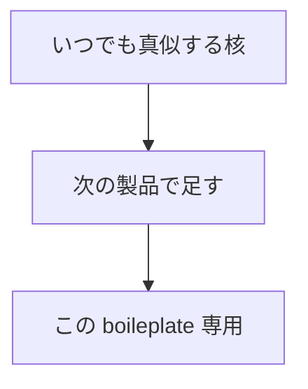
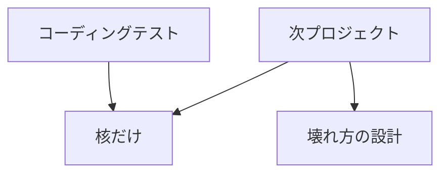
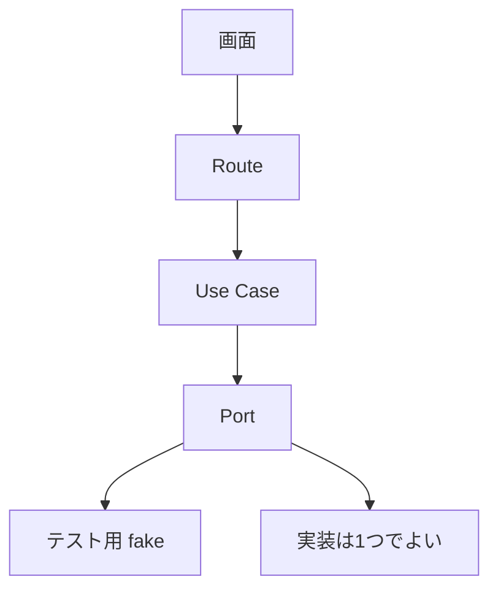

# 真似した方がいい設計と書き方

全体像は
[design-overview.md](./design-overview.md)。
これはその次の読み物。

**持っていくもの**と
**置いていくもの**を分ける。

スマホで 8 分。

---

## 1. いまの地図

### たぶん知っている

- フォルダを分けると読みやすい
- テストを書くと安心
- 環境変数は直書きしない
- エラーは握りつぶさない
- 「抽象に依存する」という言葉

### まだ見えていないことが多いもの

- テストで SDK を叩かない書き方
- 時刻を引数にしてテスト可能にする
- 失敗したとき
  **呼ばないこと**まで断言する
- ルールを lint で落とす
- コーディングテストでは
  層を減らす、という判断
- コメントは「なぜ」だけ書く

このリポジトリは製品の型。
全部コピーすると重い。
核だけ持っていく。

---

## 2. 全体像

真似の優先度は同心円。



**内側（核）**
入口・検証・エラー・Port・
「なぜ」のコメント。
テストでも次の仕事でも使う。

**中（次の製品）**
タテ切り、lint 境界、
秘密とログの一本化、
副作用をトランザクションの外へ。
チームと AI が壊す前提。

**外側（専用）**
Skills、2 プロファイル、
Stripe webhook 一式、
shadcn 全コピー。
必要になってから。



面接官が見るのは層の数ではない。
**境界の理由を話せるか**。

---

## 3. 前提

コーディングテストは時間が短い。
動くもの＋説明できる判断が点になる。

次プロジェクトは
人が増える、AI が書く、
半年後の自分が読む。
壊れ方が設計されていないと
きれいなフォルダはすぐ崩れる。

このリポジトリの優れている点は
きれいさより、
**間違った import が CI で落ちること**。
そこを理解したうえで縮小する。

---

## 4. 詳細

### A. いつでも真似する核

テストでも次でも、ここは持っていく。

**1. 入口の手順を固定する**

```
誰が → どれだけ → 何を → 実行
例外は必ず HTTP に変換
```

毎回同じだと、
抜け（認証忘れ、Zod 忘れ）が目立つ。
テストなら「誰が」は省略してよい。
手順を省略しない。

**2. 形式と業務を分ける**

- Zod = HTTP の形
  （必須、メール形式）
- Domain 関数 = 業務
  （ユーザー発言が1つ以上）

Route に if を増やさない。
Use Case の手前で
`assertValid...` が落ちる形にする。

**3. エラーは型で、status を持つ**

`DomainError` を継承する。
401 / 403 / 400 はクラスが知っている。
Route 側の switch を増やさない。

本番の 500 は内部メッセージを隠す。
SDK の文言をクライアントに出さない。

**4. 外部は interface**

Use Case は `IAIGateway` だけ知る。
テストはオブジェクトリテラルで fake。

```ts
gateway = {
  generateStream: vi.fn(),
  generate: vi.fn(),
}
```

SDK を mock しない。
約束を mock する。
これが Port の実利。

**5. 「呼ばないこと」をテストする**

このリポジトリの良い例:

履歴が空なら
`generateStream` は呼ばれない。

成功パスだけだと、
検証を消してもテストが緑のまま。

**6. 時刻・乱数は引数**

```ts
function hasActiveAccess(
  subscription: Subscription | null,
  now: Date = new Date(),
): boolean
```

デフォルトは本番どおり。
テストは `now` を固定できる。
`Date.now` を mock しなくてよい。

**7. 魔法の文字列をやめる**

`PATH.SIGN_IN`、
`SUBSCRIPTION_STATUSES as const`、
query key factory。

打ち間違いが型で落ちる。
キャッシュ破棄の取りこぼしも減る。

**8. コメントは「なぜ」**

悪い例:
「ユーザーを作る」。

良い例:
「メールはトランザクションの外。
HTTP はロールバックできないし、
外部待ちでコネクションを抱えない」。

コードで分かることは書かない。
将来の自分が
壊したくなる理由を書く。

### B. 次の製品で真似する

一人のテスト課題には重い。
チームや AI と書くなら効く。

**タテ切り**
`features/<名前>` を消せば機能が消える。
共有したくなったらそのとき `core` へ。
最初から全部 `core` に置かない。

**lint で境界**
文書だけのルールは
エージェントが飛ばす。
`no-restricted-imports` で
向きを赤にする。

**秘密・ログ・env は1箇所**
`serverEnv()`、`logger`。
`process.env` と `console.log` を
lint エラーにする。
漏れ方が揃う。

**副作用はコミットの後**
ユーザー作成と監査は
同一トランザクション。
ウェルカムメールは enqueue。
外部 HTTP を
`transaction` の中で投げない。

**お金の真実は webhook**
戻り URL で権限を付けない。
冪等（同じ event id は一度だけ）。
これが課金の核。
Checkout UI は後回しでよい。

**Query key は1か所**
`auditKeys.lists()` を invalidate。
コンポーネントに配列を散らさない。

**新しい道は非公開**
公開は許可リストへ追加。
安全側に倒れる。

**Adapter は翻訳係**
Domain の `Message` を
Gemini の `Content` に変換する。
ストリームと一括で
`prepareChat` を共有し、
設定がずれないようにする。
同じ変換を2箇所に書かない。

**env は遅延・キー単位**
Chat だけ使うのに
Notion のキーで起動失敗しない。
欠けたら変数名入りのエラー。

### C. コーディングテストでは縮小する

持っていく判断自体が点になる。



やってよい縮小:

- 層は
  Route / Use Case / Port / 実装
  の4つで十分
- ESLint ゾーンは省略可。
  代わりに README 1行
  「依存は内側へ」
- 認証はモックユーザーでよい
- 課金は
  「webhook が真実」と
  口頭で言う。実装は後回し
- UI ライブラリを全部入れない

やってはいけない縮小:

- Zod を外して `as` で通す
- Use Case から SDK を直接呼ぶ
- エラーを `catch { res.json(e) }`
- テストゼロ

面接でこう言えると強い。

「時間がないので層は薄くした。
境界は残した。
外部は Port なので
テストは fake で足りる」

### D. 書き方の型（短い）

Use Case の型:

```ts
class SendMessageUseCase {
  constructor(private readonly ai: IAIGateway) {}

  async execute(input: SendMessageInput) {
    assertValidMessageHistory(input.messages)
    const stream = await this.ai.generateStream(
      input.messages,
    )
    return { stream }
  }
}
```

- 入口は `execute`
- 依存は constructor
- 先に業務ルール、あとで Port

エラーの型:

```ts
abstract class DomainError extends Error {
  readonly status: number = 400
}

class ForbiddenError extends DomainError {
  override readonly status = 403
}
```

新しいルールを足しても
Route を触らない。

クライアントエラー:

サーバーは `{ error: string }`。
クライアントはそれを `ApiError` にする。
toast に Axios の
「status code 400」を出さない。

### E. 真似しない方がいいこと

- 層だけ増やして中身が空
- 全部を Clean Architecture と呼ぶ
- コメントでコードを復唱
- 機能をまたいで import
- テストで本物の Gemini を呼ぶ
- 成功パスだけのテスト
- 画面から `process.env` の秘密

きれいなフォルダより、
**1本の道と1つの fake** の方が
テストでも次でも強い。

---

## 5. 持っていくチェック

コーディングテストの直前:

- [ ] 入口の手順が毎回同じ
- [ ] Zod と業務ルールが分かれている
- [ ] Use Case は interface に依存
- [ ] fake で「呼ばない」テストが1本
- [ ] 500 で内部を漏らさない
- [ ] なぜ、がコメントか口頭で言える

次プロジェクトの初日:

- [ ] 上に加えてタテ切り
- [ ] 秘密とログが1箇所
- [ ] 境界が lint で落ちる
- [ ] 外部 I/O はトランザクションの外
- [ ] 課金があるなら webhook が真実

覚えるのは3つ。

- 境界を残す
- 外部は約束でテストする
- 全部はコピーしない
